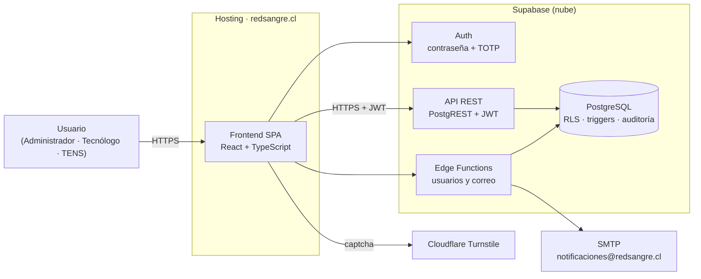

# RedSangre

**Sistema web para la búsqueda, priorización y gestión de donantes de sangre**
Proyecto APT · Capstone (PTY4614) · Ingeniería en Informática · Duoc UC, Sede Melipilla · 2026

🔗 **Sistema desplegado:** https://redsangre.cl

---

## 1. Descripción

**Qué hace.** RedSangre centraliza el registro de donantes de sangre con su grupo, fenotipo, disponibilidad y consentimientos. Ante una solicitud de transfusión, entrega en menos de un segundo una lista de candidatos compatibles ordenados por prioridad, permite contactarlos por llamada, WhatsApp o correo y deja registro de cada intento hasta cerrar la solicitud.

**A quién va dirigido.** Al personal del Departamento de Banco de Sangre de Clínica Indisa: tecnólogos médicos, TENS y coordinación (administrador).

**Qué problema resuelve.** Cuando un paciente necesita sangre con un fenotipo poco frecuente y la clínica no tiene el componente, el tecnólogo de turno busca un donante a mano, con llamadas y correos uno a uno y sin un registro central. Ese proceso puede tardar **entre 1 día y 1 semana**. RedSangre lo reduce a minutos y deja trazabilidad completa.

> Prototipo académico: trabaja **solo con datos simulados**, no reemplaza el sistema clínico e-Delphyn y no se conecta con otras instituciones.

## 2. Tecnologías utilizadas

| Capa | Tecnología |
|---|---|
| Frontend | React 19, TypeScript, Vite, React Router, CSS Modules, Recharts |
| Backend (BaaS) | Supabase: Auth (contraseña + captcha + segundo factor TOTP), API REST (PostgREST), Realtime |
| Base de datos | PostgreSQL 15 (PL/pgSQL): 11 tablas, 50 funciones, 28 triggers, 25 políticas RLS |
| Lógica en servidor | Supabase Edge Functions (Deno, TypeScript) y nodemailer |
| Seguridad | Cloudflare Turnstile, RLS, RBAC, cabeceras HSTS/CSP, auditoría inmutable |
| Hosting | Servidor LiteSpeed con dominio `redsangre.cl` (despliegue por FTPS) |
| Calidad | Vitest, ESLint, TypeScript estricto |
| Gestión | Git, GitHub, Asana, Figma, draw.io |

## 3. Ejecución local

**Requisitos:** Node.js 20 o superior, npm, Git y un proyecto de Supabase.

```bash
# 1. Clonar el repositorio
git clone https://github.com/Dav-Walker/RedSangre.git
cd "RedSangre/Fase 2/RedSangre"

# 2. Configurar variables de entorno
cp .env.example .env
#    Completar en .env:
#    VITE_SUPABASE_URL=https://tu-proyecto.supabase.co
#    VITE_SUPABASE_PUBLISHABLE_KEY=tu-clave-publicable
#    VITE_TURNSTILE_SITE_KEY=tu-site-key

# 3. Instalar dependencias y levantar la app
npm install
npm run dev        # http://localhost:5173
```

**Base de datos:** ejecutar `supabase/esquema.sql` en el editor SQL de Supabase. El script es re-ejecutable.

**Otros comandos:**

| Comando | Qué hace |
|---|---|
| `npm run build` | Revisa tipos y genera `dist/` |
| `npm test` | Pruebas unitarias (Vitest) |
| `npm run test:seguridad` | Pruebas de permisos por rol contra Supabase |
| `npm run desplegar` | Compila y sube `dist/` al hosting por FTPS |

> Nunca poner la clave `service_role` en una variable `VITE_`. El archivo `.env` está en `.gitignore`.
> El detalle técnico completo está en [`Fase 2/RedSangre/README.md`](Fase%202/RedSangre/README.md).

## 4. Integrantes y roles

| Integrante | Rol | GitHub |
|---|---|---|
| José Hernández | Gerente de proyecto · Base de datos, backend, seguridad y despliegue | [@jmhernandez-maker](https://github.com/jmhernandez-maker) |
| María Sepúlveda | Diseño UX/UI · Desarrollo frontend y backend | [@spidknit](https://github.com/spidknit) |
| David Walker | Requerimientos · Desarrollo full-stack | [@Dav-Walker](https://github.com/Dav-Walker) |

**Interesada clínica:** Nicole Hernández Alvarado, Tecnóloga Médica, Banco de Sangre de Clínica Indisa.
**Docente:** Carlos Henrique Quintanilla Galleguillos.

## 5. Metodología de trabajo

Se trabajó con **Scrum** adaptado al contexto académico, en **10 sprints de 15 días o menos**:

- **Sprint Planning** con un Sprint Goal explícito; **Daily** para detectar impedimentos; **Sprint Review** con demostración a la tecnóloga médica; **Retrospectiva** como evento aparte.
- **Product Backlog** a partir de los requisitos de la ERS (IEEE 830, RF-01 a RF-37) y **Sprint Backlog** en Asana.
- **Definition of Done:** compila sin errores de tipos, pasa lint y pruebas, se prueba con los tres perfiles (administrador, tecnólogo y TENS), se revisa en escritorio y móvil, y queda desplegado.
- **Trazabilidad:** cada tarea de Asana se relaciona con commits que citan el requisito o el sprint (por ejemplo, `RF-32, Sprint 7`) y con la funcionalidad en el sistema desplegado.

## 6. Arquitectura de la solución

Arquitectura de tres componentes desacoplados: frontend SPA, API REST y base de datos. Las reglas de negocio y la seguridad viven en PostgreSQL. Las acciones privilegiadas, como crear usuarios o enviar correos, corren en Edge Functions, así que el navegador nunca maneja claves secretas.



Diagrama de despliegue completo: [`Fase 2/EVIDENCIAS GRUPALES/Diagramas/despliegue.png`](Fase%202/EVIDENCIAS%20GRUPALES/Diagramas/despliegue.png)
Modelo de datos (MER): [`Fase 2/EVIDENCIAS GRUPALES/Diagramas/mer.png`](Fase%202/EVIDENCIAS%20GRUPALES/Diagramas/mer.png)

## 7. Estructura del repositorio

```
Fase 1/                      Acta de Constitución, ERS, EDT, Carta Gantt, MER, mockups, entrevista
Fase 2/
  EVIDENCIAS GRUPALES/       Guías, Informe de Avance, Informe Final y diagramas
  EVIDENCIAS INDIVIDUALES/   Diarios de reflexión y autoevaluaciones por integrante
  RedSangre/                 Código de la aplicación (frontend, Edge Functions, scripts)
    supabase/esquema.sql     Script completo de la base de datos
Cambios_en_PRD/              Checklist de paso a producción
```